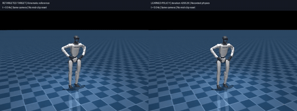
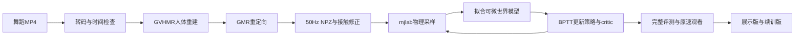

# G1 Dance on RTX 3050

**一段舞蹈视频，一张 RTX 3050 4GB，让宇树 G1 在 mjlab 仿真中学会跳舞。**

本项目串联 **GVHMR人体重建 → GMR重定向 → 接触修正 → SuperMimic预训练微调**，提供零基础中文教程、小显存适配工具、评测记录、展示权重和最终续训状态。无需真实机器人。

[详细教程](docs/tutorial/README.md) · [公开版复刻入口](docs/PUBLIC_REPRODUCTION.md) · [模型下载](https://github.com/Skura3/g1-dance-rtx3050/releases/tag/v1.0.0) · [实测结果](results/rtx3050/README.md) · [许可与来源](THIRD_PARTY_NOTICES.md)

> 本次从NJU发布的e13i_0291000预训练模型微调，保留SuperMimic的世界模型与BPTT学习方法；**不是从随机权重训练通用机器人**。训练PyTorch显存峰值低于3GB，但整卡总占用峰值高于3GB，具体口径见下表。

## 演示



[观看清晰完整MP4](docs/assets/reference_vs_policy_429526.mp4)。GIF仅降低显示帧率，动作时间轴不变。

- **参考侧**：直接播放重定向姿态，不代表物理控制成功。
- **策略侧**：429526步检查点在自由基座、重力和接触下执行的物理轨迹，没有中途重置、外力扶持或固定骨盆。
- 整段616个50Hz控制步，约12.32秒；交互查看器支持墙钟原速、暂停与视角调整。
- 演示播放使用已经验证的轨迹，**不等于实时再次执行策略推理**。

## 项目成果

- 从720×1280、30FPS、370帧的单目舞蹈视频恢复人体运动。
- 转成29关节G1参考，统一关节顺序、四元数、50Hz时轴、正运动学与速度。
- 修正漂高、局部肩部跳变、手脚支撑与接触滑动，保留原始数据和候选。
- 在RTX3050 Laptop 4GB上完成完整预训练网络的单舞蹈微调。
- 每4000步完整物理评测，最佳与最新分别保存，不把早期摔倒当作方法失败。
- 独立看护在GPU温度>100°C或迭代数>4小时不增长时请求保存停止并记录原因。
- 保留人工认可的**429526展示版**和**452376最终续训版**。

本轮由用户原速观看并认可观感后主动结束。**严格数值阈值没有全部通过，最终三种初态扰动确认未完成；不声称数学收敛或真机可部署。**

## 硬件与显存

| 项目 | 本机配置 |
|---|---|
| GPU | NVIDIA RTX3050 Laptop，4096MiB |
| CPU / RAM | Intel i5-11400H / 约15GiB |
| 系统 / 驱动 | Linux / NVIDIA535.309.01 |
| 运动处理环境 | Python3.10、Torch2.5.1+cu121、MuJoCo3.3.7 |
| 训练环境 | Python3.12、Torch2.14.1+cu126、MuJoCo/mujoco-warp3.16、warp-lang1.18.0+cu12 |
| 最终学习配置 | 64环境、WM与策略batch1024、8步WM窗口、16步想象 |

| 显存口径 | 记录峰值 | 说明 |
|---|---:|---|
| 最终训练PyTorch allocated | 2181.42MiB | Torch张量实际分配 |
| 最终训练PyTorch reserved | 2386MiB | Torch缓存分配器保留，低于3GB |
| 429526独立评测整卡采样占用 | 2958MiB | 该次评测记录，非训练全过程 |
| 最终长训阶段整卡采样占用 | 3727MiB | 含Torch、Warp、图形和其他进程 |

**可以说“4GB显卡完成微调，PyTorch显存峰值不到3GB”；不能说“训练全程整卡显存始终不到3GB”。** 采样也可能漏掉瞬时峰值。依据：[训练报告](results/rtx3050/training_final.json)、[展示版评测](results/rtx3050/evaluation_429526.json)。

最终严格训练阶段335263→452376用时约14.37小时。公开预训练计数为291000，不能把452376当作本机从零新增步数，也不能用论文H100耗时承诺3050收敛时间。

## 展示版质量

| 指标 | 429526检查点 |
|---|---:|
| 完整物理执行 | 616步 / 12.32秒，failed=false |
| 全身关节RMSE | 0.1640rad，约9.40° |
| 手臂关节RMSE | 0.1803rad |
| 最差连续2秒关节RMSE | 0.2313rad |
| 平均 / 峰值根位置误差 | 6.51 / 15.45cm |
| 平均 / 峰值偏航误差 | 5.10 / 39.04° |
| 平均 / 峰值相对倾斜误差 | 5.35 / 17.06° |

误差相对于**重定向后的G1参考**，不是原视频真人的真实三维运动。RMSE不等于逐关节最大误差；偏航/倾斜仍有超限，局部存在可见偏差。最终452376只用于续训，没有另行证明优于429526。

## 从视频到策略



SuperMimic反复进行物理采样、拟合世界模型、通过模型中的短期想象和critic未来价值改进策略。它属于基于模型的强化学习，**不是PPO，也不是逐帧复制参考关节角**。策略更新时固定世界模型权重，但保留通过模型对动作求导的梯度。详见[第01章](docs/tutorial/01_从零理解与论文.md)。

## 快速开始

### 获取项目和固定源码

```bash
git clone https://github.com/Skura3/g1-dance-rtx3050.git
cd g1-dance-rtx3050
export G1_PROJECT_ROOT="$(pwd)"
python3 tools/bootstrap_sources.py --list
python3 tools/bootstrap_sources.py
```

源码按固定commit恢复，应用本地补丁并核对SHA256。每项下载最多尝试两次，失败打印手动下载位置；已有third_party不会被覆盖。

### 环境与外部文件

按[公开版入口](docs/PUBLIC_REPRODUCTION.md)和[环境教程](docs/tutorial/02_环境与下载.md)准备两个Python环境。SMPL-X需要自行注册并接受模型许可；视觉权重和Torch/Warp wheel使用教程列出的来源与路径。无需实机SDK。

只观看成果不需要原视频或重新重建。换新舞蹈需自行提供视频、重新做接触标注与缓存。本机流程已工作；洁净安装路线尚未在第二台电脑端到端验证。

### 原速打开成果

从[Release](https://github.com/Skura3/g1-dance-rtx3050/releases/tag/v1.0.0)下载checkpoint_429526.pt与g1_scene.mjb至data/releases/v1.0.0/：

```bash
python3 tools/prepare_public_demo.py --mode display
MUJOCO_GL=glfw OMP_NUM_THREADS=1 OPENBLAS_NUM_THREADS=1 \
envs/training/.venv/bin/python -B docs/tutorial/scripts/view_comparison.py \
  --report outputs/public_demo/replay_report.json \
  --checkpoint data/releases/v1.0.0/checkpoint_429526.pt \
  --model data/releases/v1.0.0/g1_scene.mjb \
  --status outputs/public_demo/view_status.json
```

需要桌面会话与对应MuJoCo3.16环境。左参考、右策略；空格暂停、回车重播。

### 自己操作训练流程

参考动作已附在examples/reference_dance/。可以先跳过视觉处理学习训练，也可从自己的MP4完整重做：

1. [视频→人体→G1动作](docs/tutorial/03_视频到机器人动作.md)。
2. [加载、站立、公开权重基线、anchor迁移、短测与长期训练](docs/tutorial/04_开始训练.md)。
3. [判断进步、播放、停止、保存与续训](docs/tutorial/05_评估播放与续训.md)。
4. [夜间看护与常见报错](docs/tutorial/07_操作清单与排错.md)。

教程另有随机初始化教学分支，但未在这台4GB机器上验证同等舞蹈收敛。默认推荐本次实际成功的**预训练微调**路线。

### 从最终状态续训

另下载Release中的checkpoint_final_452376.pt，按[公开版续训入口](docs/PUBLIC_REPRODUCTION.md)执行。恢复world model、policy、critic、三个优化器与采样统计；replay buffer、现场仿真和RNG未序列化，需64步预热。展示版保持独立，最新不一定最好。

## 小显存适配与NJU借鉴

| 内容 | 实际处理 |
|---|---|
| 视觉推理 | batch1、FP16预处理、图像留CPU、分阶段进程、缓存来源校验 |
| 动作转换 | 关节/四元数/单位显式检查、50Hz FK与速度、接触修正 |
| 训练内存 | 保留完整网络，降低环境数、缓存与想象时域，限制诊断batch |
| 运算效率 | 同层身体批量FK，核对前向与梯度，不改物理关节限制 |
| 预训练能力 | NJU e13i_0291000检查点与低学习率微调经验 |
| 位置/朝向反馈 | 使用上游anchor_obs，680→689维零列扩展并迁移Adam状态 |
| 困难段 | NJU tilt-hinge、重点reset机制，使用本片问题窗口 |
| 训练管理 | 低频完整评测、最佳与最新分开、原子保存与独立看护 |

anchor_obs在CuboiLeo基础复现中已存在，不能全部归为NJU原创。NJU腰部耦合、IMU饱和、真实失败状态回灌等真机改动**没有在最终实验启用**。具体出处、未采用方案与早期方法更正见[第06章](docs/tutorial/06_改动出处与复刻边界.md)。

## 仓库结构

```text
tools/                    视频、训练、评测、展示与适配工具
configs/                  配置、上游固定版本、补丁、校验和
envs/training/            训练依赖与uv锁文件
examples/reference_dance/ G1参考与429526物理轨迹
results/rtx3050/          显存、质量与状态原始报告
docs/tutorial/           7章零基础中文教程
docs/PUBLIC_REPRODUCTION.md  GitHub副本操作入口
tests/                   数据、指标、配置和看护回归检查
vendor/                  保留许可的精简PyTorch3D源码包
LICENSES/                第三方原始许可
```

大权重放Release。虚拟环境、CUDA wheel、SMPL-X、视觉权重、原视频、完整论文与训练缓存不进入Git。旧docs是阶段性记录，其中“尚未训练”对应当时；当前结果以本README和results为准。

## 验证与边界

发布前核对教程命令/语法与本地链接；源码恢复补丁在临时副本验证了精确哈希和重复执行；检查点哈希、轨迹帧数、关节顺序和有限值已核对。没有为发布重新运行长训或修改原机冻结权重。

```bash
python3 docs/tutorial/scripts/check_tutorial.py
```

短测通过不是收敛证据。单目重建有深度/遮挡/比例不确定性，接触修正会改变动作；策略依赖仿真anchor状态，没有真机验证或全面抗扰动保证。

## 许可与致谢

**原创编排代码与原创文档采用MIT**，见[LICENSE](LICENSE)。上游代码、补丁中的上游材料、模型权重和数据保留其许可：GVHMR/SMPL-X存在非商业或研究限制，NJU及衍生检查点仍受BONES-SEED等条款约束。详见[第三方声明](THIRD_PARTY_NOTICES.md)。

感谢[SuperMimic论文](https://arxiv.org/abs/2610.28480)、[CuboiLeo复现](https://github.com/CuboiLeo/SuperMimic-Reproduced)、[NJU复现](https://github.com/NJU-R-L-Group-Embodied-Lab/SuperMimic-Repro-Sim2Real)、[mjlab](https://github.com/mujocolab/mjlab)、[GVHMR](https://github.com/zju3dv/GVHMR)、[GMR](https://github.com/YanjieZe/GMR)、MuJoCo、Warp、PyTorch3D与各模型作者。

本项目不是论文作者官方实现，也不隶属于宇树或上述研究团队。
